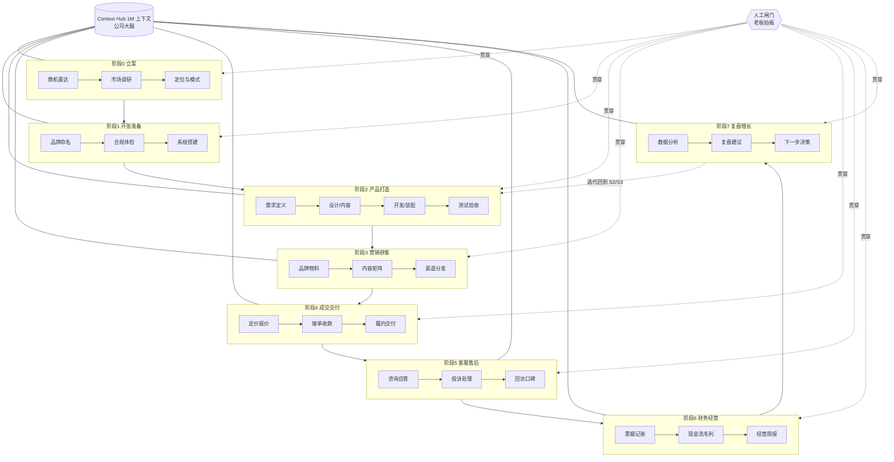

# OPC · 一人公司 —— 全流程 MiMo 打通蓝图

> JUNCTION CHINA 2026「OPC · 一人公司」赛题 · 技术支持包（完整版）
> 目标：一位人类老板 + 一支 MiMo Agent 团队，40 小时内跑通 **立案 → 开张 → 获客 → 成交 → 交付 → 售后 → 记账 → 复盘** 的完整闭环，做出「第一单」。
> 模型：MiMo-V2.6-Pro｜1M 上下文 ｜ 多模态 ｜ Tool Use ｜ Coding ｜ 办公 ｜ 设计 ｜ 科研 ｜ 创作 ｜ 网络安全 ｜ 电脑操控

---

## 0. 总览

### 0.1 一人公司全景



### 0.2 三层总架构

| 层 | 是什么 | 谁负责 |
|---|---|---|
| **执行层** | 各阶段业务 Agent（调研/设计/开发/营销/客服/会计…） | 专职 Agent |
| **编排层** | COO Agent：拆任务、派活、收结果、卡节点、升级 | COO Agent |
| **中枢层** | Context Hub：公司唯一事实来源（1M 上下文）+ 人工闸门 + 留痕 | Hub + 老板 |

**三条铁律（贯穿全程）**

1. **单一事实来源**：所有 Agent 读写 Context Hub，禁止各自存一套版本。
2. **不可逆动作必须过闸**：付钱、对外发信、删数据、法律承诺、公开发声 → 只准备材料，老板拍板。
3. **全部留痕**：每个动作有日志与截图，出错可回滚到任意节点重跑。

### 0.3 Context Hub 内容清单（公司大脑）

| 卷宗 | 内容 | 何时写入 |
|---|---|---|
| `00-charter.md` | 公司宪章：定位、用户、价值主张、红线 | 阶段 0 |
| `01-market.md` | 市场调研、竞品、定价带 | 阶段 0 |
| `02-brand.md` | 命名、VI、语调、禁词 | 阶段 1 |
| `03-product.md` | 需求、设计稿、产品说明 | 阶段 2 |
| `04-ops.md` | SOP、话术库、FAQ、权限表 | 阶段 2–5 |
| `05-pipeline.md` | 内容/渠道/线索/订单台账 | 阶段 3–4 |
| `06-finance.md` | 票据、收支、毛利、现金流 | 阶段 4–6 |
| `07-log.md` | 全量动作日志与截图索引 | 全程 |
| `08-review.md` | 周报、复盘、决策记录 | 阶段 6–7 |

---

## 1. 阶段 0 · 立案（0–3h）

**目标**：想清楚「做谁的什么生意」，产出一页公司宪章。
**出口交付物**：`00-charter.md` + `01-market.md`

### 编排

```
老板口述想法
   → 商机雷达（发散 3 个方向）
   → 并行调研 ×3（市场/竞品/用户）
   → 定位收敛（选 1 个）
   → 人类闸门①：老板拍板做什么
   → 写入公司宪章
```

### Agent 职责

| Agent | 输入 | 动作 | 输出 | MiMo 能力 |
|---|---|---|---|---|
| 商机雷达 | 老板一句话 | 发散 3 个可做方向，各给「需求强度/竞争/启动成本」打分 | 方向卡 ×3 | 复杂推理 |
| 市场调研员 | 选定方向 | 行业规模、趋势、目标人群画像 | `01-market.md` 上半 | 科研 + 1M 上下文 |
| 竞品侦察兵 | 选定方向 | 爬公开信息，列 5 个竞品：卖点、定价、差评 | `01-market.md` 下半 | 电脑操控 |
| 定位官 | 两份调研 | STP、价值主张、商业模式画布 | 宪章草案 | 复杂推理 |
| 书记员 | 老板裁决 | 固化 `00-charter.md` | 宪章 | 办公 |

### 人工闸门①
老板从 3 个方向里选定 1 个（或打回重来）。**Agent 不得替老板决定做什么生意。**

### 失败重跑
调研 Agent 输出若缺少「数据来源」字段 → 自动打回补料，最多 2 次。

---

## 2. 阶段 1 · 开张准备（3–5h）

**目标**：有名字、有脸面、有工作台，法律与安全上不踩雷。
**出口交付物**：`02-brand.md` + `04-ops.md`（权限表）+ 可访问的官网/店铺骨架

### 编排

```
品牌命名（出 5 个名字）
   → 闸门②：老板定名
   → VI 与语调（logo 需求/色板/话术风格）
   → 合规体检（商标重名、禁词、隐私）
   → 系统搭建（官网、邮箱、表格、店铺）
   → 权限与密钥台账
```

### Agent 职责

| Agent | 输入 | 动作 | 输出 | MiMo 能力 |
|---|---|---|---|---|
| 命名师 | 宪章 | 5 个候选名 + 域名/商标粗查 | 名单 | 创作 + 电脑操控 |
| 设计总监 | 选定名 | 色板、logo 需求单、海报模板、PPT 模板 | `02-brand.md` | 设计 + 多模态 |
| 文案总监 | 宪章 | 品牌语调、禁用词、slogan ×3 | `02-brand.md` | 创作 |
| 合规体检官 | 品牌与业务 | 商标/重名/广告法禁词/隐私合规清单 | 体检报告 | 网络安全意识 |
| 搭建工 | 品牌包 | 生成官网首页、店铺页、邮箱签名、记账表骨架 | 可访问链接 | Coding + 电脑操控 |
| 权限管理员 | 系统清单 | 账号、密钥、权限分级台账 | `04-ops.md` 权限表 | 网络安全 |

### 人工闸门②
**定名**（不可逆）。合规体检出现红色项 → 必须老板确认后才能继续。

### 失败重跑
官网搭建后自动做一次移动端截图检查，版式崩了打回重做。

---

## 3. 阶段 2 · 产品打造（8–12h，最长一段）

**目标**：做出能卖的东西（实物/服务/课程/软件均可）。
**出口交付物**：`03-product.md` + 可演示可交付的产品 + 测试报告

### 编排（双轨：产品定义 → 生产 → 质检）

```
需求定义（用户故事 + 验收标准）
   → 闸门③：老板确认卖什么、卖点是什么
   → 并行生产轨：
        轨 A 设计/内容（视觉、文案、课件、服务包）
        轨 B 开发/装配（代码、自动化、配置）
   → 质检 Agent 对着验收标准逐条打勾
   → 不通过 → 定向修复（最多 3 轮）
   → 交付物打包
```

### Agent 职责

| Agent | 输入 | 动作 | 输出 | MiMo 能力 |
|---|---|---|---|---|
| 产品经理 | 宪章 + 调研 | 用户故事、功能清单、验收标准（DoD） | `03-product.md` v1 | 复杂推理 |
| UX/设计 | 需求 | 页面结构、视觉稿、包装/物料图 | 设计稿 | 设计 + 多模态 |
| 内容制作 | 需求 | 详情页、说明书、课件、服务手册 | 内容包 | 创作 + 1M 上下文 |
| 开发工程师 | 需求 | 代码实现、脚本、配置 | 仓库/系统 | Coding |
| 测试员 | 验收标准 | 用例执行、Bug 复现、回归 | 测试报告 | Coding + Tool Use |
| 安全审计 | 系统与数据 | 依赖漏洞、权限、隐私、注入面 | 安全清单 | 网络安全 |
| 质检官 | 以上全部 | 对照 DoD 打分，决定放行/打回 | 质检单 | 复杂推理 |

### 人工闸门③
**卖什么、卖点、承诺范围** 老板确认。质检不通过且 3 轮未修好 → 升级老板决定砍需求。

### 失败重跑
测试员报 Bug 时，输出必须含「复现步骤 + 期望/实际」，开发 Agent 才受理。

---

## 4. 阶段 3 · 营销获客（4–6h，可与阶段 2 部分并行）

**目标**：让目标用户看到你，并产生第一批线索。
**出口交付物**：`05-pipeline.md`（内容台账 + 线索台账）+ 已发布物料

### 编排

```
内容策略（平台 × 人群 × 信息点）
   → 并行内容生产（长文 / 短帖 / 海报 / 短视频脚本）
   → 品牌合规检查（禁词、调性、承诺边界）
   → 闸门④：对外发布前老板扫一眼
   → 渠道分发（真实发帖/上架/群发）
   → 线索收集与打分
```

### Agent 职责

| Agent | 输入 | 动作 | 输出 | MiMo 能力 |
|---|---|---|---|---|
| 增长策略 | 宪章 + 产品 | 渠道选择、发布节奏、钩子设计 | 内容策略 | 复杂推理 |
| 文案 ×2 | 策略 | 长文、短帖、私信话术 | 内容库 | 创作 |
| 设计 | 策略 | 海报、封面、banner | 视觉物料 | 设计 |
| 视频脚本 | 策略 | 分镜、口播、字幕稿 | 脚本 | 视频理解 + 创作 |
| 合规检查官 | 全部物料 | 禁词、夸大宣传、承诺风险 | 检查单 | 网络安全意识 |
| 发布员 | 过审物料 | 真实操作平台发布/排期 | 发布凭证（截图） | 电脑操控 |
| 线索官 | 互动数据 | 收集咨询，按意向打分入 `05-pipeline.md` | 线索台账 | 办公 |

### 人工闸门④
**所有对外公开发布**（帖子/公告/投放）过老板一眼——不审内容细节，审「是否说得出去」。

### 失败重跑
发布失败（平台报错）自动换文案重试 1 次，仍失败则记录并跳过，不空转。

---

## 5. 阶段 4 · 成交与交付（3–5h）

**目标**：跑通「第一单」——报价、收款、履约、回执。
**出口交付物**：订单记录 + 交付物 + 收款/收据凭证

### 编排

```
线索进入
   → 报价官（依据定价表出报价）
   → 闸门⑤：老板确认价格与条款
   → 合同/订单生成
   → 闸门⑥：收款动作（真实付款必须老板执行或确认）
   → 履约调度（交付物组装、发货/开通/交付会）
   → 完成回执 + 订单入账
```

### Agent 职责

| Agent | 输入 | 动作 | 输出 | MiMo 能力 |
|---|---|---|---|---|
| 报价官 | 线索 + 定价表 | 报价单、折扣建议、条款要点 | 报价单 | 办公 + 推理 |
| 法务 | 标准条款 | 订单/服务协议要点，标风险条款 | 合同草案 | 办公 + 风控 |
| 谈判助手 | 沟通记录 | 异议处理话术、让步方案 | 话术 | 创作 |
| 订单员 | 已确认交易 | 建订单、排交付计划 | 订单记录 | 办公 |
| 交付调度 | 订单 | 组装交付物、排交付动作 | 交付包 | Tool Use |
| 收银员 | 订单 | 生成收款链接/账单/收据 | 收款凭证 | 办公 / 电脑操控 |

### 人工闸门⑤⑥（两道）
⑤ **价格与条款**确认；⑥ **实际收付款**——Agent 只能生成账单与链接，**资金动作必须老板执行/确认**。

### 失败重跑
交付物校验（缺文件/缺章节）自动补齐，最多 2 次；仍缺则列出缺口升级老板。

---

## 6. 阶段 5 · 客服与售后（全程在线，2–3h 建好体系）

**目标**：不漏单、不惹事、有口碑。
**出口交付物**：FAQ 库 + 工单系统 + 升级机制

### 编排

```
会话进入
   → 前台接待（多轮应答、意图识别）
   → 风险判定
        ├─ 普通咨询 → 自动结案
        ├─ 疑难 → 转专家 Agent
        └─ 高风险（投诉/退款/舆情/法律）→ 闸门⑦ 升级老板
   → 工单记录 → 回访 → 归档进 04/05 卷宗
```

### Agent 职责

| Agent | 输入 | 动作 | 输出 | MiMo 能力 |
|---|---|---|---|---|
| 前台客服 | 用户消息 | 基于 FAQ 与订单上下文应答 | 会话 | 多模态（语音可选） |
| 风控质检 | 会话 | 定级：普通/疑难/危机 | 风险标签 | 复杂推理 |
| 专家坐席 | 疑难工单 | 深度解答，必要时查文档/订单 | 解答 | 1M 上下文 |
| 危机专员 | 高风险工单 | 生成处置方案与对外口径草案 | 处置建议 | 创作 + 风控 |
| 回访员 | 结案工单 | 满意度回访、要好评、归档 | 回访记录 | 办公 |

### 人工闸门⑦
**投诉、退款、舆情、法律** 一律升级；危机专员只出方案，不说最后一句。

### 失败重跑
前台应答置信度低（自评 < 阈值）→ 自动转专家，不硬答。

---

## 7. 阶段 6 · 财务与经营（2–3h 体系 + 每日 10min 跑批）

**目标**：账清、数明、老板心里有底。
**出口交付物**：`06-finance.md` + 一页纸经营周报

### 编排

```
每日：票据采集 → 记账 → 异常标记
每周：对账 → 毛利与现金流 → 经营周报 → 闸门⑧ 老板看报决策
```

### Agent 职责

| Agent | 输入 | 动作 | 输出 | MiMo 能力 |
|---|---|---|---|---|
| 票据员 | 发票/截图/邮件 | 识别录入、分类 | 票据台账 | 多模态 |
| 会计 | 票据 + 订单 | 记账、应收应付、毛利 | `06-finance.md` | 办公 |
| 财务分析 | 账目 | 环比、异常、单位经济 | 分析页 | 复杂推理 |
| 秘书 | 分析 | 一页纸周报 + 3 条建议 | `08-review.md` | 创作 / 办公 |
| 催收员 | 应收 | 生成催款话术与提醒 | 催款动作 | Tool Use |

### 人工闸门⑧
**周报决策**（继续/调价/砍品线）。催款对外发送前过老板。

---

## 8. 阶段 7 · 复盘与增长（1–2h）

**目标**：让这家公司越跑越聪明。
**出口交付物**：`08-review.md` 复盘页 + 下一轮 backlog

### 编排

```
全量日志与数据汇入
   → 复盘官（做得好/不好/为什么）
   → 机会雷达（新需求、新渠道、竞品异动）
   → 生成下一轮 backlog（排优先级）
   → 闸门⑨：老板定下一步
   → 回流到阶段 2/3，进入下一轮迭代
```

### Agent 职责

| Agent | 输入 | 动作 | 输出 | MiMo 能力 |
|---|---|---|---|---|
| 复盘官 | 全卷宗 | 成败归因、数据支撑 | 复盘页 | 1M 上下文 + 推理 |
| 机会雷达 | 外部信息 | 每周抓 3 个新机会/风险 | 雷达简报 | 电脑操控 |
| 规划师 | 复盘 + 雷达 | backlog、优先级、资源估算 | 下一轮计划 | 复杂推理 |

### 人工闸门⑨
**下一步做什么** 老板定。Agent 只提供选项与依据。

---

## 9. 横切机制（全程必须有）

### 9.1 COO Agent（总编排）

- 任务队列：从宪章派生当日任务板
- 节点卡控：上一阶段出口未达标，不得进入下一阶段
- 升级规则：卡住 >30 分钟 / 出现红色风险 → 唤醒老板
- 每日站会：10 分钟自动汇总「昨天/今天/卡点」

### 9.2 人工闸门总表

| 闸门 | 事项 | 阶段 |
|---|---|---|
| ① | 做什么生意 | 0 |
| ② | 定名；合规红项 | 1 |
| ③ | 卖什么、承诺范围 | 2 |
| ④ | 对外公开发布 | 3 |
| ⑤ | 价格与条款 | 4 |
| ⑥ | 真实收付款 | 4 |
| ⑦ | 投诉/退款/舆情/法律 | 5 |
| ⑧ | 周报决策、对外催款 | 6 |
| ⑨ | 下一步战略 | 7 |

### 9.3 留痕与回滚

- 每个 Agent 动作写入 `07-log.md`：时间、Agent、输入摘要、输出、工具调用、截图索引
- 任何节点可「回滚重跑」：COO 从失败节点重派，已产出物标记为 `stale`
- 重要输出自动留版本（v1/v2/v3），闸门决策与版本号绑定

### 9.4 安全基线（网络安全贯穿）

- 密钥只进权限台账，不进对话正文
- 所有浏览器/系统操作走白名单
- 对外内容过禁词与承诺检查
- 敏感数据（客户、支付）最小化采集与脱敏展示

---

## 10. 40 小时执行节奏（建议）

| 时段 | 内容 | 对应阶段 |
|---|---|---|
| 0–3h | 立案与定位 | 阶段 0 |
| 3–5h | 命名、VI、合规、搭系统 | 阶段 1 |
| 5–17h | 产品打造（最长） | 阶段 2 |
| 13–19h | 营销物料与发布（与生产并行） | 阶段 3 |
| 19–24h | 拉线索、报价、**第一单** | 阶段 4 |
| 24–28h | 客服体系上线，跑会话 | 阶段 5 |
| 28–32h | 记账、对账、周报 | 阶段 6 |
| 32–36h | 复盘、迭代一版产品/内容 | 阶段 7 → 2/3 |
| 36–40h | 打磨演示、写提交材料 | 汇总 |

**演示优先级**：先把「第一单」跑通，再补周报与复盘——评委要看闭环，不是全功能。

---

## 11. 3 分钟演示脚本（评委视角）

1. **0:00–0:30** 展示公司宪章与 Context Hub：「这是我们的公司大脑，所有 Agent 共用。」
2. **0:30–1:30** 现场跑一单：输入客户消息 → 报价 → **闸门弹出给老板确认** → 收款凭证 → 交付包生成。
3. **1:30–2:15** 插入一次失败重试：故意让测试/合规 Agent 打回一次，展示日志与自动修复。
4. **2:15–2:45** 一键生成经营周报 + 复盘建议。
5. **2:45–3:00** 收尾：「一个人，一支 AI 团队，40 小时，开张营业并跑通第一单。」

---

## 12. 最小可运行裁剪版（如果时间不够）

只保 **四段闭环**，其余用文档占位：

1. 阶段 0 立案（含闸门①）
2. 阶段 2 产品（只做一条主产品线）
3. 阶段 4 **第一单**（含闸门⑤⑥）
4. 阶段 6 一页纸周报

仍然满足赛题判定：**产品可访问 + 闭环可演示 + 至少跑通一单**。

---

## 13. 交付物清单（提交用）

| 类型 | 文件 |
|---|---|
| 公司卷宗 | `00-charter.md` … `08-review.md` |
| 产品 | 官网/店铺链接、产品包、测试与安全报告 |
| 营销 | 发布凭证截图、内容台账 |
| 交易 | 报价单、订单、收款凭证、交付回执 |
| 运营 | FAQ、工单记录、经营周报 |
| 工程 | Agent 编排代码/配置、日志、失败重跑记录 |
| 演示 | 3 分钟演示视频或现场 demo |

---

> 本蓝图可直接作为选手技术手册。需要把其中任一阶段展开成「Agent 提示词 + 工具调用伪代码 + 输出 JSON Schema」，指定阶段即可。
