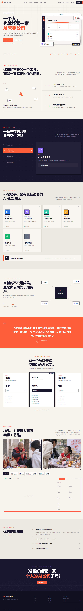
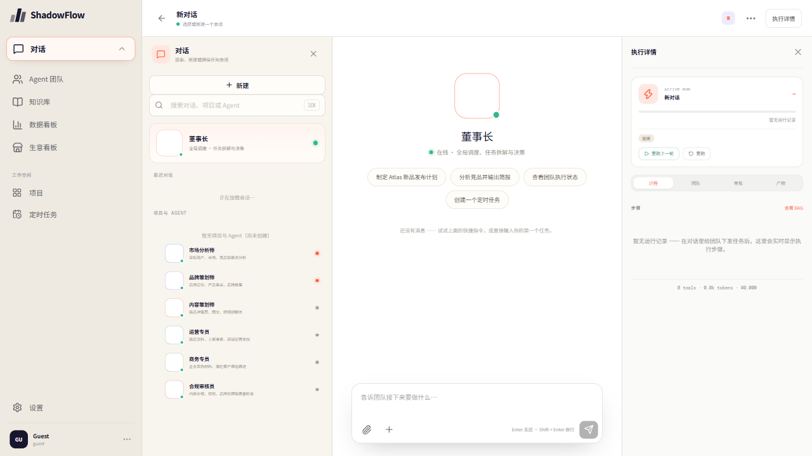

# 03 · 产品链接

## 交付信息

| 项目 | 说明 |
| --- | --- |
| 访问地址 | **<https://kingston-schema-russia-appreciate.trycloudflare.com>** |
| 地址记录 | `link.md` |
| 上线形态 | 公网隧道（cloudflared 快速隧道 → 本机服务 :8443），公网任意网络可访问 |
| 页面截图 | `01-首页宣传页.png`、`02-董事长工作台.png` |
| 交付日期 | 2026-11-08 |

## 链接能看什么

| 入口 | 内容 |
| --- | --- |
| `/`（产品宣传页） | 作品首页：一句话定位、AI 员工团队、交付链路、定价、手工艺品代销主题演示 |
| `/#/app`（董事长工作台） | 对话式指挥 6 人 Agent 团队（市场分析师 / 品牌策划师 / 内容策划师 / 运营专员 / 商务专员 / 合规审核员），含执行详情、Agent 团队、知识库、数据看板、生意看板 |

## 页面截图

| 首页宣传页 | 董事长工作台 |
| --- | --- |
|  |  |

## 保活与安全说明

1. **存活条件**：隧道由演示机托管，主机在线即链接可用；域名由 Cloudflare 快速隧道动态分配。
2. **安全加固**：API Key 类敏感接口已完成四层防护——公网来源一律 403 拦截、只读配置列表深度脱敏（仅留尾 4 位），本机使用不受影响（2026-11-08 实测：公网访问密钥接口返回 403）。
3. **稳定性修复**：keepAlive + CORS + SPA 托管修复见 PR #71。

## 诚实标注（请评委留意）

1. 链接为**公网隧道地址**（非云服务器固定域名），域名由 trycloudflare.com 动态分配，链接寿命与演示主机在线时间一致。
2. 演示数据为手工艺品代销场景；社交平台分发与快递承运商环节使用模拟回执（系统内已明示），核心链路为真实运行，详见 02 演示视频「诚实标注」。
