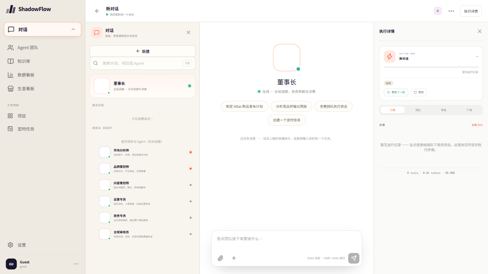

# 产品访问地址

| 项目 | 说明 |
| --- | --- |
| 访问地址 | <https://kingston-schema-russia-appreciate.trycloudflare.com> |
| 工作台直达 | <https://kingston-schema-russia-appreciate.trycloudflare.com/#/app> |
| 交付日期 | 2026-11-08 |
| 访问方式 | 公网直连，浏览器打开即用（Guest 访问，无需账号） |
| 上线形态 | cloudflared 公网隧道（免注册快速隧道）→ 本机服务 :8443 |
| 存活说明 | 主机在线即用；隧道域名由 Cloudflare 动态分配，与演示主机共存亡 |

## 截图

